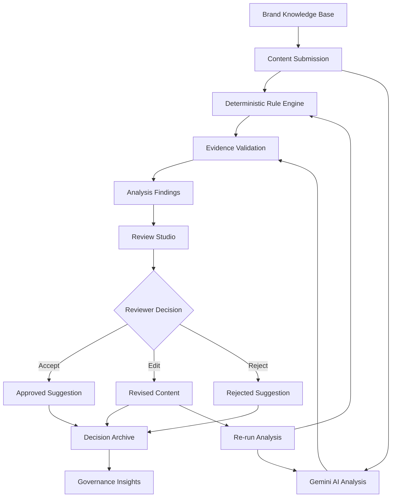
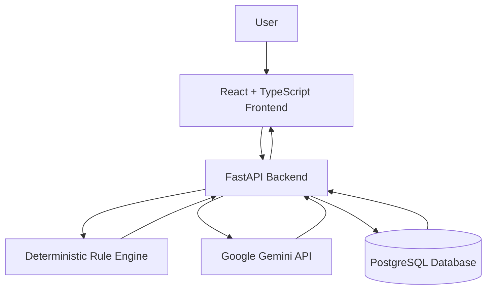

# BrandGuard AI
### Evidence-Grounded Brand Governance & Content Review Platform

BrandGuard AI is an AI-powered platform that helps teams maintain brand consistency and review marketing content before publication. It combines deterministic rule-based checks with Gemini-powered contextual analysis to identify unsupported claims, inconsistent messaging, and violations of brand guidelines.

---

## 1. Problem Statement

Organizations often maintain brand guidelines, approved terminology, product facts, and communication rules across multiple documents and platforms.

As a result:
- Marketing content may contain unsupported or inaccurate claims.
- Brand terminology and tone may be applied inconsistently.
- Reviewers may struggle to trace findings back to approved information.
- Manual reviews can be time-consuming and difficult to track.

BrandGuard AI addresses these challenges through a centralized, evidence-grounded content review workflow.

## 2. Proposed Solution

BrandGuard AI brings brand knowledge, content analysis, and human review into one platform.

Users can store approved brand information, submit content for analysis, inspect evidence-backed findings, and decide whether to accept, edit, or reject suggested corrections.

The platform combines two analysis approaches:

- **Deterministic analysis:** Checks content against configured rules and brand requirements.
- **AI-powered analysis:** Uses Google Gemini to identify contextual issues and suggest improvements.

AI findings are advisory. Final decisions remain with the human reviewer.

## 3. Key Features

### Brand Intelligence
A centralized knowledge base for managing:
- Brand guidelines and communication rules.
- Approved terminology and preferred wording.
- Product facts and approved claims.
- Knowledge sources used during content verification.

### Content Analysis
- Rule-based checks for configured brand requirements.
- Gemini-powered contextual analysis.
- Detection of inconsistent messaging and potentially unsupported claims.
- Findings with severity, explanations, and suggested corrections.

### Evidence Validation
- Checks whether findings reference approved knowledge-base records.
- Validates quoted evidence against stored information.
- Withholds mismatched or unapproved citations.
- Identifies claims that lack sufficient supporting evidence.

### Review Studio
- Review individual findings and their supporting information.
- Accept, edit, or reject suggested corrections.
- Preserve the revised content.
- Re-run analysis after making changes.

### Re-analysis and Audit History
- Re-analyse updated content using the same review.
- Avoid duplicate findings where possible.
- Preserve existing reviewer decisions and audit history.
- Record analysis status, reviewer information, and outcomes.

### Governance Insights
Provides insights derived from stored review data, helping users understand recurring issues and areas that may need improvements to brand guidelines.

## 4. System Workflow

The main workflow takes content from submission through analysis and human approval.



## 5. System Architecture

The application uses a React frontend, FastAPI backend, PostgreSQL database, and Gemini API integration.



**Architecture responsibilities:**

| Component | Responsibility |
|---|---|
| React frontend | User interface, content submission, review and insights |
| FastAPI backend | API endpoints and application logic |
| Rule engine | Deterministic brand compliance checks |
| Gemini API | Contextual content analysis and suggestions |
| PostgreSQL | Brand knowledge, reviews, findings and audit records |
| SQLAlchemy | Database interaction and models |

## 6. Technology Stack

| Layer | Technology |
|---|---|
| Frontend | React 19, TypeScript |
| Styling | Tailwind CSS |
| Icons | Lucide |
| Backend | Python, FastAPI |
| Database | PostgreSQL |
| ORM | SQLAlchemy |
| AI integration | Google Gemini API |
| Build tool | Vite |

## 7. Analysis Reliability and Failure Handling

BrandGuard AI distinguishes between different analysis outcomes instead of treating every empty result as a successful review.

It handles:
- Analysis completed with findings.
- Analysis completed with no new findings.
- Deterministic analysis completed while Gemini failed.
- Both analysis methods failing.
- Analysis services being unavailable or unconfigured.

Failures are reported honestly, and users can retry analysis. Re-analysis also preserves existing decisions, including rejected review decisions and their audit history.

An analysis with no findings is not a guarantee that content is completely safe or compliant.

## 8. Changes from the Round 1 Proposal

The Round 1 proposal described the planned architecture and intended features. During Round 2, the project developed into a working application with an integrated frontend, backend, database, rule engine, Gemini analysis, evidence validation, review workflow, and governance insights.

The implementation also introduced more detailed analysis-status handling and safeguards for evidence references and review decisions.

Some proposed capabilities, including visual content analysis and accessibility checks, remain future improvements rather than completed features.

## 9. Testing and Validation

The project has been tested across backend logic, database operations, API behaviour, and frontend builds.

Testing includes:
- Evidence validation unit tests.
- Backend API and database checks.
- Re-analysis scenarios and finding deduplication.
- Gemini failure and recovery handling.
- Preservation of reviewer decisions.
- Frontend linting and production build.

**Latest reported backend test result:** 11 tests passed.

## 10. Screenshots

The screenshots below demonstrate the main application workflows. Keep the images in `docs/screenshots/` and ensure the filenames match the references.

### Application Overview


### Brand Intelligence and Content Management


### Content Submission and Analysis


### Review and Decision Workflow


### Decision Archive and Governance


### Additional Application Screens


## 11. Setup and Installation

### Prerequisites

- Node.js and npm
- Python
- PostgreSQL
- Google Gemini API key

### Clone the Repository

```bash
git clone https://github.com/adoraeden/brandguard-ai.git
cd brandguard-ai
```

### Backend Setup

```bash
cd backend
python -m venv .venv
```

Activate the virtual environment, then install dependencies:

```bash
pip install -r requirements.txt
```

Create a `.env` file in the backend directory containing:

```env
DATABASE_URL=your_postgresql_connection_string
GEMINI_API_KEY=your_gemini_api_key
```

Configure your PostgreSQL database and start the FastAPI backend using the project's run configuration.

### Frontend Setup

Install dependencies in the frontend project directory:

```bash
npm install
```

Start the Vite development server using the development script defined in `package.json`.

**Security note:** Do not commit `.env` files, API keys, database credentials, or other secrets to GitHub.

## 12. Limitations

The current implementation is a functional hackathon prototype. Some areas require further development before production use:

- Authentication is intended for demonstration and is not production-grade.
- Evidence validation checks approved records and textual matches but does not guarantee complete semantic entailment.
- AI analysis depends on external API availability.
- The platform does not automatically publish reviewed content.
- Organization-level role-based access control is not fully implemented.
- Visual and accessibility analysis is not yet available.

## 13. Future Scope — Round 3

The next development phase will focus on strengthening the existing platform.

### 1. Stronger Evidence Reasoning
Improve semantic verification, confidence indicators, uncertainty handling, and false-positive reduction.

### 2. Improved Review Workflow
Introduce clearer original-versus-revised comparisons, version tracking, and better reviewer collaboration.

### 3. Advanced Governance Intelligence
Identify recurring brand violations, detect gaps in existing guidelines, and provide actionable recommendations.

## 14. Project Links

- **GitHub Repository:** https://github.com/adoraeden/brandguard-ai
- **Live Demo:** To be added after deployment.
- **Project Documentation PDF:** Add the final submission PDF link.

---

*BrandGuard AI — Making brand content reviews more consistent, evidence-based, and transparent.*
